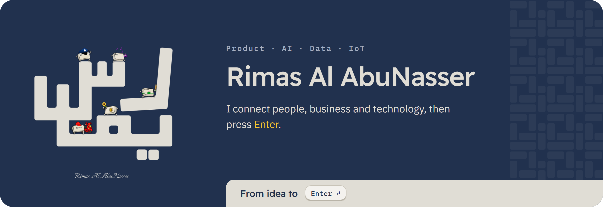
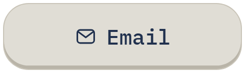
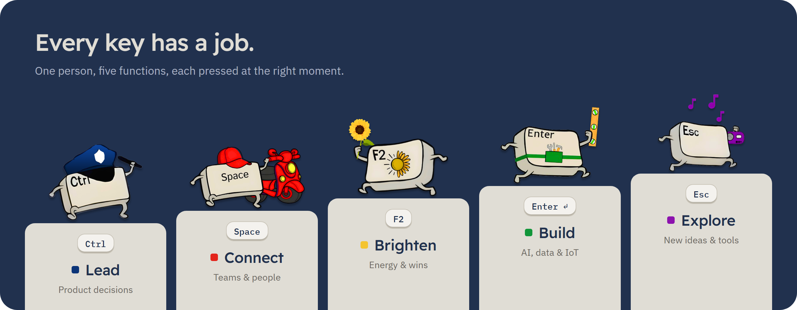

  &nbsp;
  &nbsp;
  

Hi, I'm Rimas. I work where product, data and hardware meet: I write the user stories, plan the sprints, wire the sensors and train the models, then help the team ship.

## Selected work

**[3-Eye RoadScan](https://github.com/saravii7/3-EyeRoadScanProject)** · AI capstone, 2026 A team system that finds road damage in photos and ranks repairs by priority. I trained and compared the YOLO models, picked the final one and tuned its confidence threshold. [Live demo](https://3eye-roadscan.streamlit.app)

**Rewaa** · Smart irrigation · 3rd place, Tech Connect 2025 Irrigation guided by sensor data. I managed the project and built the entire hardware (ESP32 and sensors).

**Burhan** · Amad Hackathon, with Alinma Bank &amp; Tuwaiq Academy An AI platform idea that answers questions about financial regulations from the actual rules, with sources (RAG). I led the technical side.

**Kameel** · Startup founder An AI project-management startup. I led a team of 6 to a prototype at CODE LAB, King Khalid University.

**Sunflower Solar Tracker** · 1st place, Node-RED Bootcamp 2023 A solar panel that turns to follow the light. I did the programming, wiring and hardware.

## Teaching & community

- Taught **69 children** in STEM and robotics programs at Milhaa · BotBox, as lead trainer.
- Trained **71 people** in 3D design and printing at Tuwaiq Academy.
- Designed a data analytics course from scratch and taught **40 sessions** at Mishkat.
- Led the organizational management department of the Computer Club at King Khalid University.

## Toolkit

**Product:** user stories, backlogs, sprint planning, Jira, market research **Data & AI:** Python, SQL, Power BI, Tableau, YOLO, RAG **IoT:** Arduino, ESP32, Node-RED, sensors, 3D printing
