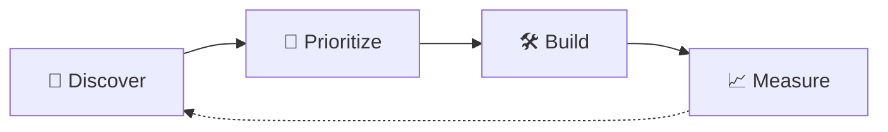

# Rimas AbuNasser

### Product Management · Data · AI

*Turning user needs and data into purposeful technology products.*

---

### At a glance

| 🧭 Product & Business | 📊 Data & Decisions | 🤖 AI & Technology |
|:---:|:---:|:---:|
| Product ownership | Python · SQL | Machine learning |
| User stories & backlogs | Power BI · Tableau | Computer vision |
| Requirements & stakeholders | KPIs & dashboards | Model evaluation |

### How I approach products

### Featured project

**3-Eye RoadScan** · *Collaborative AI Engineering capstone*

| Problem | Solution | My contribution |
|:---|:---|:---|
| Road damage reporting and maintenance decisions | Detection · prioritization · duplicate finding | **YOLO detector** · model evaluation · confidence threshold · experiments E2–E4 |

---

**Information Systems (Data Science concentration)**

*Product ownership · Business analysis · Data analytics · Applied AI*

[LinkedIn](https://www.linkedin.com/in/rimas-al-abunasser/) · [Athar Portfolio](https://rimas-al-abunasser.github.io/)

